

# Prism · Sims 4 Manager

**A free, open-source mod and custom-content manager for The Sims 4: visual, careful, and honest about what it knows.**

[Website](https://archangelaries.github.io/Prism-Sims4-Manager/) · [Screenshots](#screenshots) · [Status](#status) · [Contact](#contact)

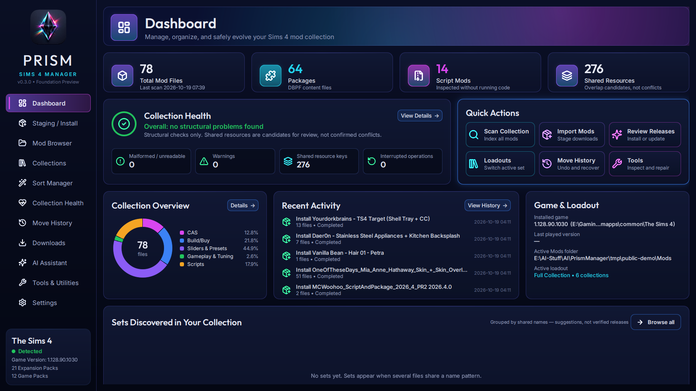

> **Status: in active development.** This repository currently holds documentation, screenshots and licensing only. The source code will be published here when the first public release is ready.

## What Prism does

Prism helps you install, browse, organize and troubleshoot large Sims 4 collections (tested on 43,000+ files) without guessing and without risking your Mods folder.

- **Safe installs and updates.** Downloads are staged and analyzed first. You review exactly which files move and which versions are replaced, then Prism installs them as one transaction that you can undo, and that recovers safely after a crash or power loss. Prism never overwrites a file.
- **Evidence over filenames.** Prism reads what is inside each package (resource types, CAS body types, embedded thumbnails and script versions) instead of trusting names. Shared resources are reported as candidates to review, never presumed conflicts.
- **Mod Browser.** A fast visual gallery of everything installed, with embedded previews, categories, folders, suggested sets, and per-file details.
- **Collections and loadouts.** Group related content, then switch gameplay loadouts in one undoable step. Nothing is deleted when you switch.
- **Sort Manager.** Previewable organization driven by package contents. Named sets, script releases and overrides stay together, and every move can be undone.
- **Collection Health and game error logs.** Find files the game will not load, contested resources, and the installed mods that appear in exception tracebacks.
- **Missing requirements, found and fetched.** Prism finds what your mods need but don't have:
  - script frameworks they import, read from compiled code without running it;
  - mods and packs their creators declare as required;
  - CAS items whose mesh is missing.

  For each one it names the official source. It downloads through official APIs where a site allows it; otherwise it opens the creator's page and watches your Downloads folder. It checks that the file really provides what was missing, then installs it through the same reviewed, undoable flow.
- **Mod Doctor.** When a game update breaks a script mod, Prism reads the game's error reports and the mod's compiled code (without running it). An AI model or agent writes a small, separate compatibility fix. Prism checks it before you see it: no file, network or process access, no hiding errors, no invented code. One approval installs it into `Mods/Prism Patches`. The original mod is never changed, you can undo the fix any time, and an official update from the creator is still the best fix.
- **Downloads and sources.** Prism records where each download came from and checks those sources for newer files where the site allows it. It uses Nexus Mods through its official API with your own key, reads public Mod The Sims pages only when you ask, and works with your browser for everything else. CurseForge support is waiting on API approval. Prism never bypasses logins, captchas, paywalls or site rules.
- **Exact Duplicate Finder.** Byte-identical copies, confirmed with SHA-256. Extra copies go to a vault, never to the recycle bin.
- **Build/Buy by catalog.** Build/Buy subfolders (seating, lighting, plumbing, decor...) come from each object's own Buy/Build catalog tags, the same categories the game uses. On a 43,000-file test collection, the number of Build/Buy files Prism could place confidently went from about 6,700 to 17,800.
- **AI Assistant (optional).** Works with local models (LM Studio, Ollama, llama.cpp, vLLM and more) or your own cloud keys (Anthropic, OpenAI, Gemini). It only reads your collection and suggests the right screen for any change. It cannot install, move or delete anything, and every change stays yours to approve. Settings recommends local models that fit your PC, with results Prism measured on real hardware.
- **Agents (optional).** Claude Code, Codex and other MCP clients can use Prism's tools to inspect your collection and draft Mod Doctor fixes. They can only change files after you turn on reviewed agent changes and approve the exact plan. Fixes written by small local models are often wrong: Prism rejects what it can detect and recommends stronger models for code.

## Screenshots

| | |
|---|---|
| 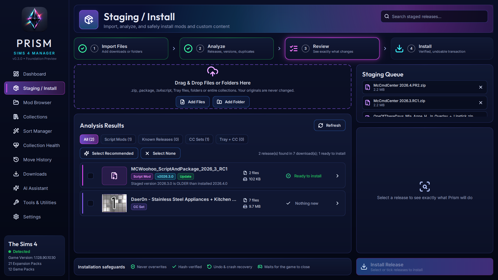 **Staging / Install**: review releases, versions and replacements before anything moves | 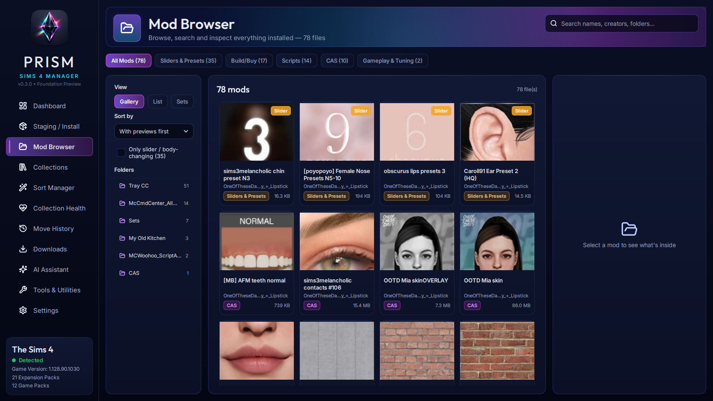 **Mod Browser**: embedded previews and content categories |
| 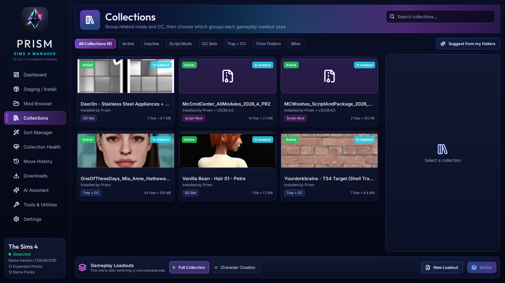 **Collections & Loadouts**: group content, switch sets safely | 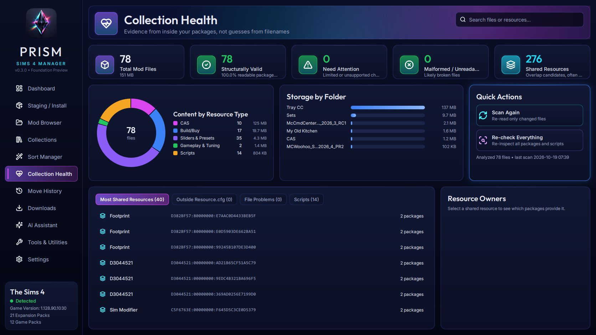 **Collection Health**: evidence from inside your packages |
| 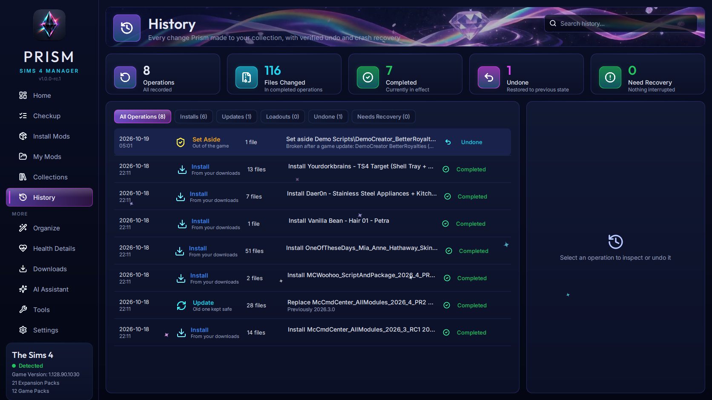 **Move History**: every change recorded, undoable and recoverable | 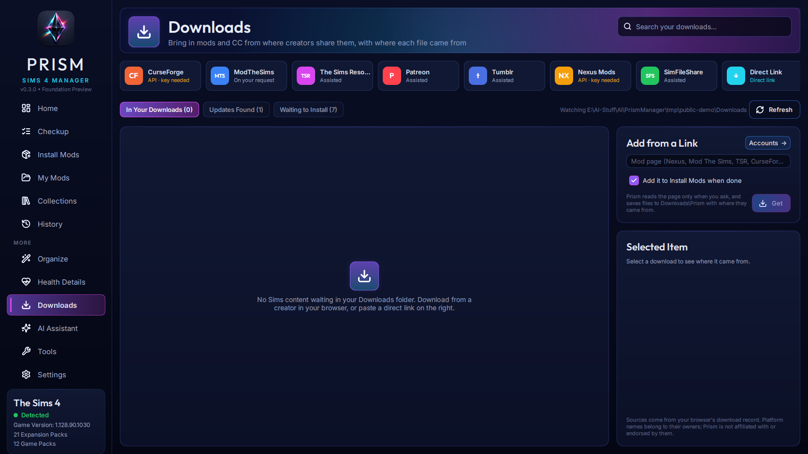 **Downloads**: sources and where each file came from |
| 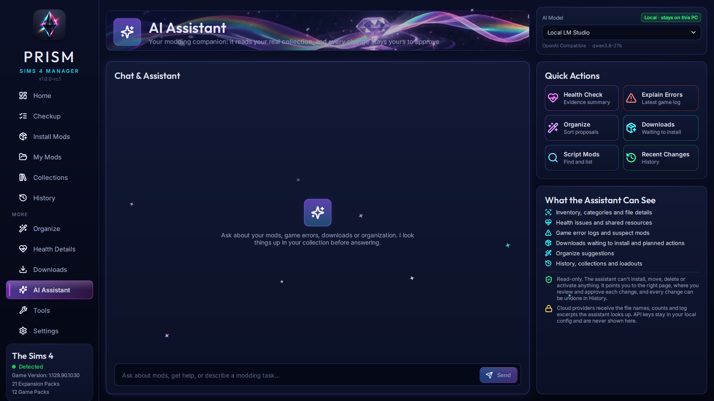 **AI Assistant**: read-only help with real tools | 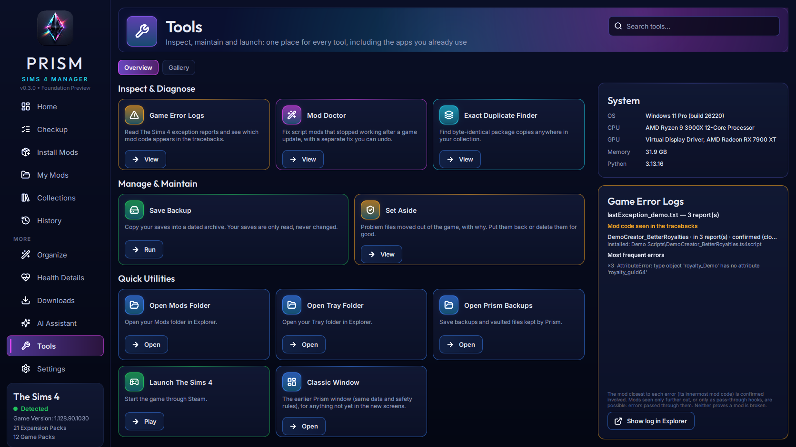 **Tools & Utilities**: inspectors, maintenance and external apps |
| 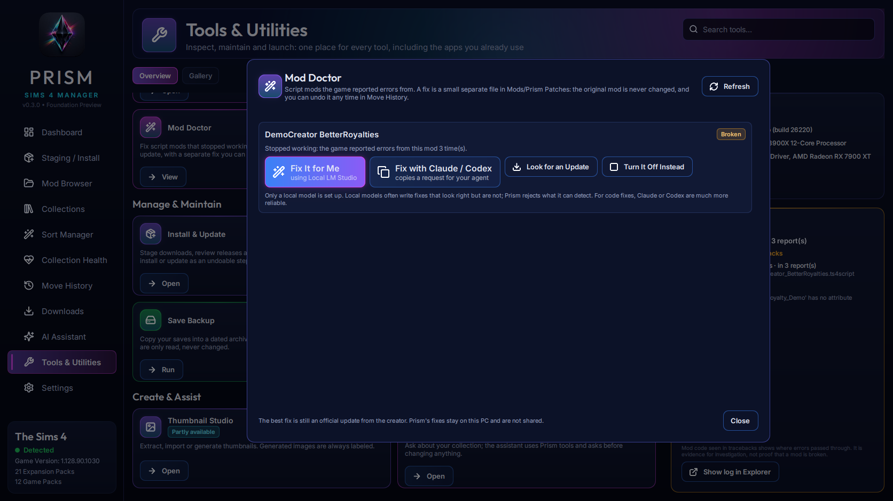 **Mod Doctor**: a broken script mod, explained in plain language with one-click options | 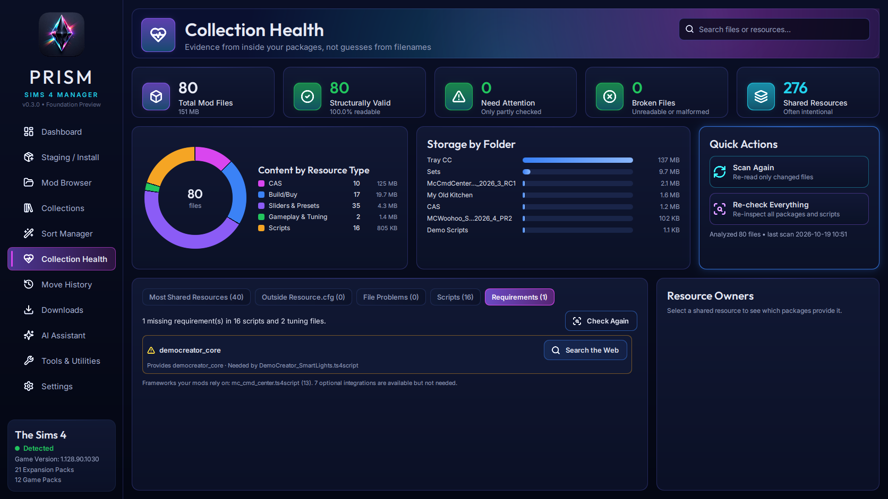 **Missing requirements**: what your mods need and where to get it |
| 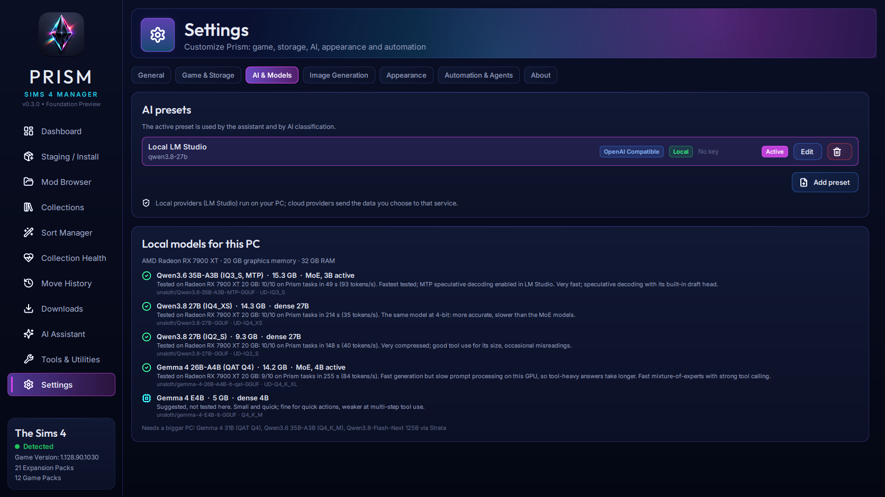 **AI & Models**: tested local models that fit your PC | |

Screenshots show a small demo collection. Custom content shown belongs to its creators. The broken "DemoCreator" mods in the Mod Doctor and Requirements screenshots are made-up examples.

## Principles

1. **Your collection comes first.** Changes are previewed, approved, recorded and reversible. The game must be closed before files move.
2. **No guessing presented as fact.** Prism labels uncertainty: suggested sets are suggestions, shared resources are candidates, and generated images are marked as generated.
3. **Respect for creators and platforms.** Prism keeps attribution and download pages, follows each site's terms, and never strips paywalls or early-access restrictions.
4. **AI is optional and never acts alone.** Anything an assistant or agent proposes goes through the same preview, approval and undo as everything else.
5. **Free forever.** No paid tiers. Donations may be accepted in the future.

## Status

Prism runs on Windows with Python and Qt (PySide6 / Qt Quick). It is being built and tested against real collections. Planned before the first public release: a guided collection checkup with one-click fixes, quarantine for problem files, a Windows installer, Thumbnail Studio for missing previews, theme options, and broader platform integrations.

## License

Prism is free software under the **GNU General Public License v3.0 or later**. See [LICENSE](LICENSE) and [NOTICE](NOTICE). Copies and modified versions must keep the attribution *"Based on Prism Sims 4 Manager by ArchAngelAries and Prism contributors."*

Prism is a fan-made tool. It is not affiliated with, endorsed by, or sponsored by Electronic Arts or Maxis. The Sims is a trademark of Electronic Arts Inc. Mod platform names belong to their respective owners; Prism is not affiliated with them.

## Contact

Questions, ideas and feedback are welcome through [GitHub Issues](https://github.com/ArchAngelAries/Prism-Sims4-Manager/issues).
