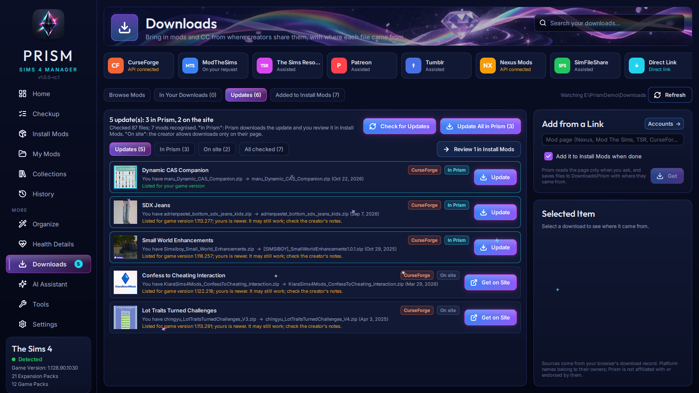
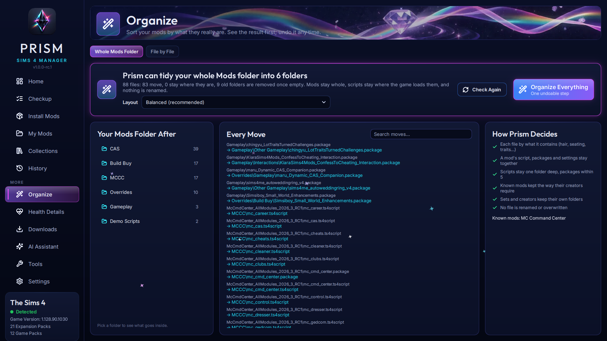
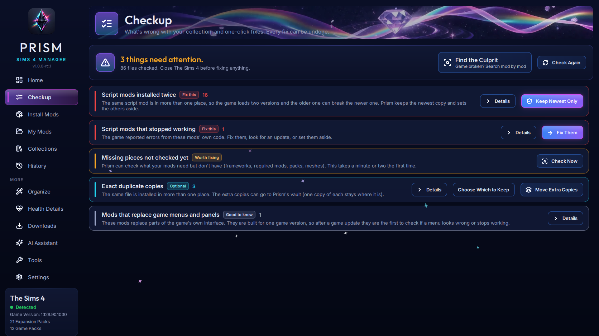
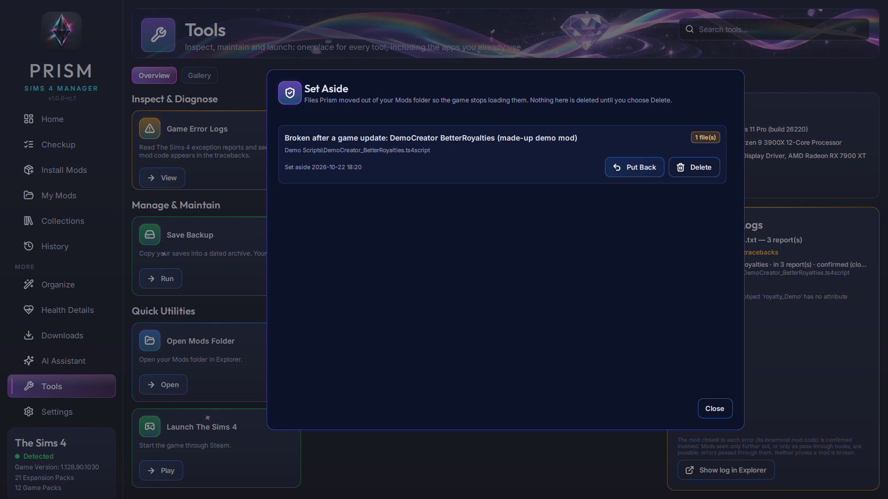
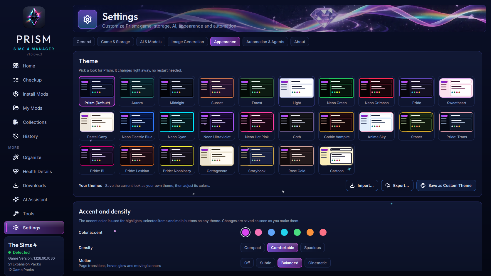
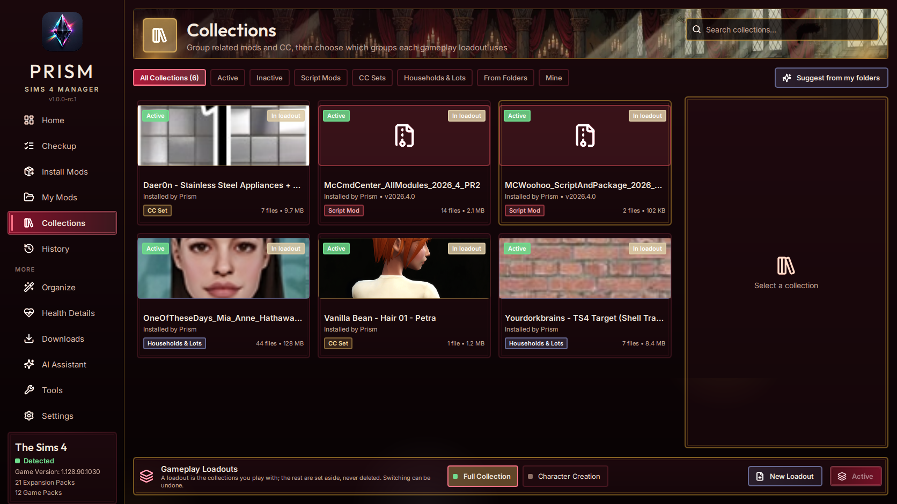
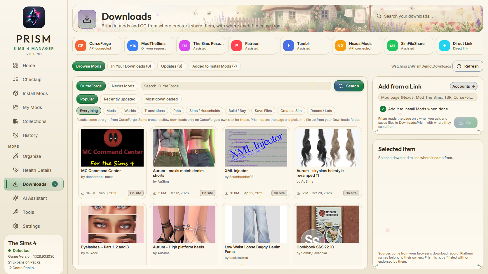

# Prism · Sims 4 Manager

**A free, open-source mod and custom-content manager for The Sims 4: visual, careful, and honest about what it knows.**

[Website](https://archangelaries.github.io/Prism-Sims4-Manager/) · [Screenshots](#screenshots) · [Status](#status) · [Contact](#contact)

> **Status: 1.0 release candidate.** Prism now has a Windows installer and is being tested before its first public release. This repository holds documentation, screenshots and licensing; the source code will be published here with that release.

## What Prism does

Prism helps you find, install, update, organize and troubleshoot large Sims 4 collections (tested on 43,000+ files) without guessing and without risking your Mods folder.

- **Browse and download inside Prism.** Search CurseForge (by section: Mods, Create a Sim, Build/Buy and more) and Nexus Mods without leaving the app. Pick a mod, pick a file, and Prism downloads it and adds it to Install Mods for review. Files whose creator allows downloads only on their own page open that page instead, and Prism picks the file up from your Downloads folder.
- **Updates in one place.** Prism recognises which of your installed mods come from CurseForge, even ones you installed long before Prism, from the files themselves (only fingerprint numbers are sent, never your files or their names). It shows every update with what you have and what's new, which game version the new file is listed for, and how to get it: **In Prism** (one click, or Update All) or **On site** (the creator's page opens). Mods you downloaded from Nexus Mods or Mod The Sims are checked too, when you ask. The sidebar shows how many updates are waiting.
- **Nexus Mods "Mod Manager Download".** Optionally, Nexus's download buttons can send their files straight to Prism, also for free accounts. Prism shows which program handles those links now and gives them back when you turn this off or uninstall.
- **Malware protection without running anything.** Every download is checked before it can be installed: files pretending to be something else, programs hidden inside mods, script mods that reach for passwords or browsers, known-bad files, downloads from risky hosts, and a Windows Defender scan of each new batch. Downloads that say they came from CurseForge or Nexus Mods are confirmed with that site. Prism never runs a file to check it, and it is honest that no check can prove a mod is safe.
- **Checkup.** One screen that tells you what's wrong with your collection in plain language, most important first, each with one fix button. It covers broken files, files too deep in folders for the game to load, script mods that stopped working, missing requirements, CAS items that will be invisible, duplicates, and fixes to confirm after playing. Every fix can be undone.
- **Set Aside.** Take problem files out of the game without deleting them. Prism keeps the reason, and you can put them back any time. Deleting is your choice alone: files go to the Windows Recycle Bin, and the assistant and agents can never delete anything.
- **Safe installs and updates.** Downloads are staged and analyzed first. You review exactly which files move and which versions are replaced, then Prism installs them as one transaction that you can undo, and that recovers safely after a crash or power loss. Prism never overwrites a file.
- **Sim and lot downloads.** Bundled CC and sliders you already have are skipped, even under another file name (Prism matches the item IDs inside). If a bundled slider would replace one of yours, Prism asks: all of them, the ones you tick, or none. Renamed tray copies the game would ignore are left out, and incomplete households or lots are flagged.
- **Big mods installed right.** Mods with their own layout, like Create-A-World and Better BuildBuy, are installed exactly as their creators require, and Prism warns about conflicts their creators name.
- **Evidence over filenames.** Prism reads what is inside each package (resource types, CAS body types, embedded thumbnails and script versions) instead of trusting names. Shared resources are reported as candidates to review, never presumed conflicts.
- **Organize everything.** Your whole Mods folder in one clean layout (CAS, Build/Buy, Gameplay, Overrides, Animations & Poses), planned in seconds even for 43,000 files and applied as one undoable step. Overrides are found by what a package replaces, not by its name. Mods stay whole, scripts stay where the game loads them, and your settings folders and deliberate choices stay put. New installs land in the layout you chose; a new player's folders are left as they made them.
- **Build/Buy by catalog.** Build/Buy subfolders (seating, lighting, plumbing, decor...) come from each object's own catalog tags, the same categories the game uses.
- **My Mods, Collections and loadouts.** A fast visual gallery of everything installed, with embedded previews and per-file details. Group related content, then switch gameplay loadouts in one undoable step. Nothing is deleted when you switch.
- **Missing requirements, found and fetched.** Script frameworks your mods import (read from compiled code without running it), mods and packs their creators declare as required, and CAS items whose mesh is missing. Each comes with its official source, and Prism gets it for you where the site allows.
- **Game update impact and Mod Doctor.** After a game update, Prism lists the script mods whose code uses game functions that changed, before you launch. When one breaks, Mod Doctor explains why and gets a small, separate, safety-checked fix written, which you install with one approval and can undo any time. The original mod is never changed.
- **Find the Culprit.** When something is broken and nobody knows which mod, Prism narrows it down step by step, turning groups of mods off and back on, with every step undoable.
- **Themes.** 27 built-in themes, from Prism's own crystal look to Neon, Gothic Vampire, Anime Sky, Cottagecore, Storybook, Rose Gold, Cartoon and Pride flags, each with its own animated banner, effects and finishes. Save your own theme, change its colors, corners, glow and effects, use fonts installed on your PC, and share themes as files. Imported themes are checked like downloads: pictures and settings only, nothing that could run.
- **Pictures.** Give a mod or a collection your own picture, the one from its download page, or an AI-generated one (ComfyUI on your PC, OpenAI or Gemini). Generated pictures are always labelled.
- **AI Assistant (optional).** Works with local models (LM Studio, Ollama, llama.cpp, vLLM and more) or your own cloud keys (Anthropic, OpenAI, Gemini). It only reads your collection and suggests the right screen for any change. Its answers come from your real collection, Prism's built-in guide and a final check, so even small local models stay accurate. Requests to change Prism itself are pointed to this repository's Issues.
- **Agents (optional).** Claude Code, Codex and other MCP clients can use Prism's features through its tools. Changes are off until you allow them, and you choose who approves each one: **Ask me every time**, **Approve for me** (Prism's own AI approves routine, undoable changes and asks you about anything else) or **Always approve**. Code that would run in the game, whole-folder moves and downloads with safety findings always ask you.
- **Private by design.** API keys are encrypted for your Windows account and never shown in full. Prism opens programs it finds on your PC only after showing you exactly which file it is. Every build is checked so that no personal data or keys can ship inside it.

## Screenshots

| | |
|---|---|
|  **Browse Mods**: search CurseForge and Nexus Mods inside Prism |  **Updates**: in Prism or on the site, with the game version each file lists |
|  **Install Mods**: review releases, versions and replacements before anything moves |  **Organize**: your whole Mods folder in one clean layout, previewed first |
|  **My Mods**: embedded previews and content categories |  **Home**: what needs attention, and a Play button |
|  **Checkup**: what's wrong, in plain language, with one-click fixes |  **Set Aside**: problem files out of the game, kept with the reason, undoable |
|  **Collections & Loadouts**: group content, switch sets safely |  **Missing requirements**: what your mods need and where to get it |
|  **Mod Doctor**: a broken script mod, explained, with options you approve |  **Collection Health**: evidence from inside your packages |
|  **Themes**: 27 built-in looks, your own themes, import and export |  **Gothic Vampire**: one of the themes, with its own banner |
|  **Cottagecore**: a light theme with its own art |  **History**: every change recorded, undoable and recoverable |
|  **AI Assistant**: read-only help with real tools |  **AI & Models**: tested local models that fit your PC |
|  **Tools & Utilities**: error logs, Mod Doctor, duplicates, backups | |

Screenshots show a small demo collection. Custom content shown belongs to its creators. The broken "DemoCreator" mods are made-up examples.

## Principles

1. **Your collection comes first.** Changes are previewed, approved, recorded and reversible. The game must be closed before files move.
2. **No guessing presented as fact.** Prism labels uncertainty: suggested sets are suggestions, shared resources are candidates, safety checks say what they can't promise, and generated images are marked as generated.
3. **Respect for creators and platforms.** Prism keeps attribution and download pages, follows each site's terms and each creator's download choices, and never strips paywalls or early-access restrictions.
4. **AI is optional and never acts alone.** Anything an assistant or agent proposes goes through the same preview, approval and undo as everything else.
5. **Free forever.** No paid tiers. Donations may be accepted in the future.

## Status

Prism runs on Windows with Python and Qt (PySide6 / Qt Quick), installs with a normal Windows installer, and is used daily on a real 43,000-file collection. Working now: browsing, downloading and updating from CurseForge and Nexus Mods, malware checks, installs and updates into a clean layout, whole-folder Organize, the Checkup, Set Aside, Find the Culprit, Mod Doctor, missing requirements, game update impact, the in-game probe, 27 themes with custom and shareable themes, pictures, and AI for local models, cloud models and agents. Before the first public release: in-game testing of the probe, Nexus Mods app registration (sign in with Nexus), and more theme families.

## License

Prism is free software under the **GNU General Public License v3.0 or later**. See [LICENSE](LICENSE) and [NOTICE](NOTICE). Copies and modified versions must keep the attribution *"Based on Prism Sims 4 Manager by ArchAngelAries and Prism contributors."*

Prism is a fan-made tool. It is not affiliated with, endorsed by, or sponsored by Electronic Arts or Maxis. The Sims is a trademark of Electronic Arts Inc. Mod platform names belong to their respective owners; Prism is not affiliated with them.

## Contact

Questions, ideas, bug reports and feature requests are welcome through [GitHub Issues](https://github.com/ArchAngelAries/Prism-Sims4-Manager/issues).
